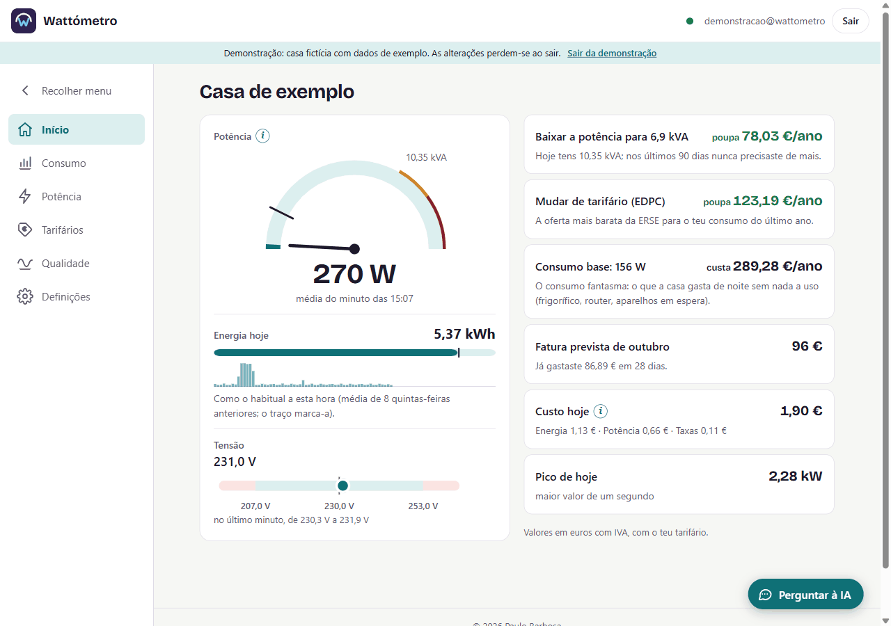
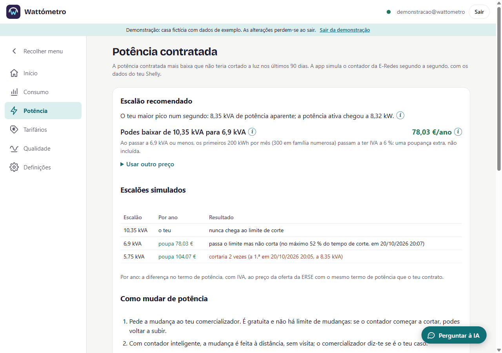
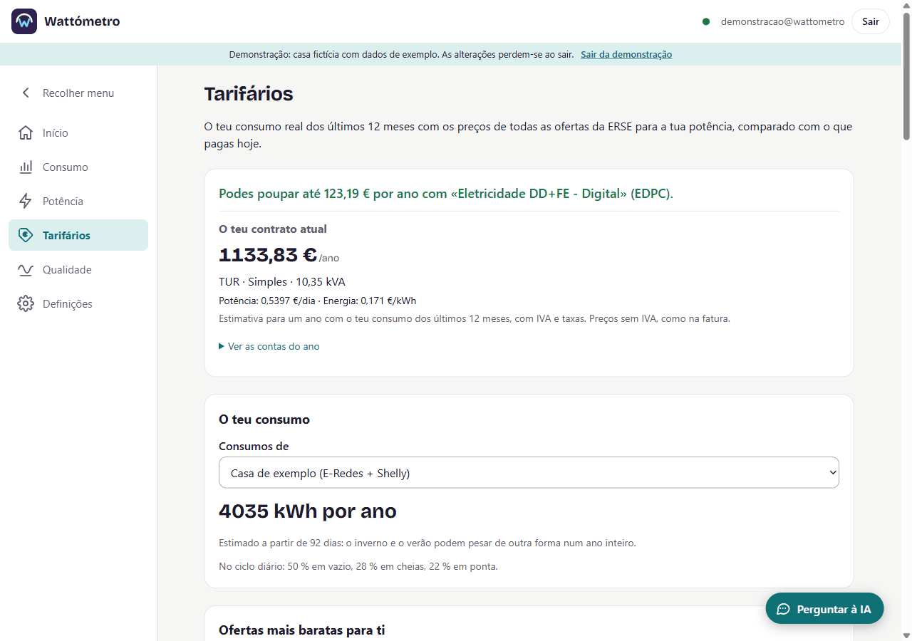
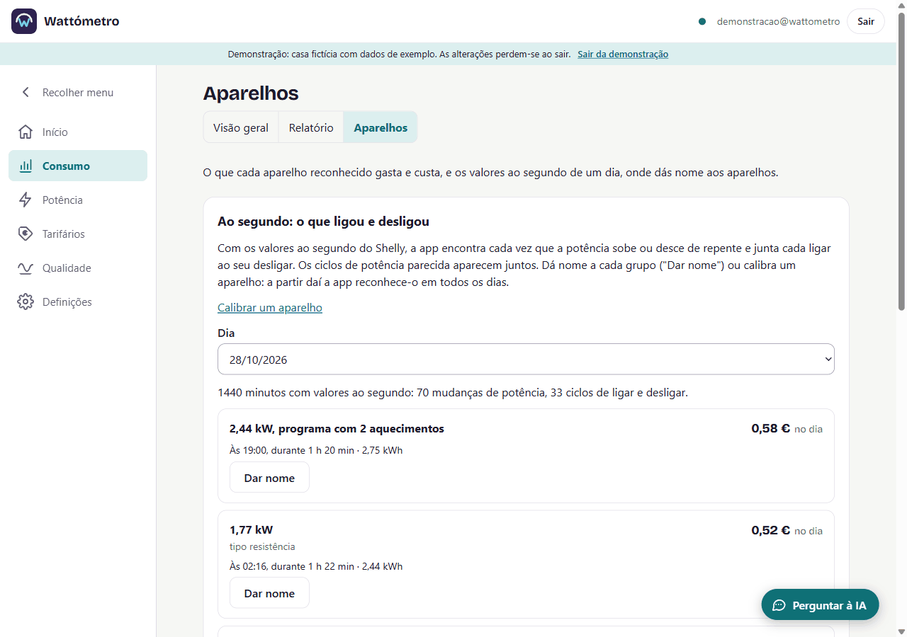
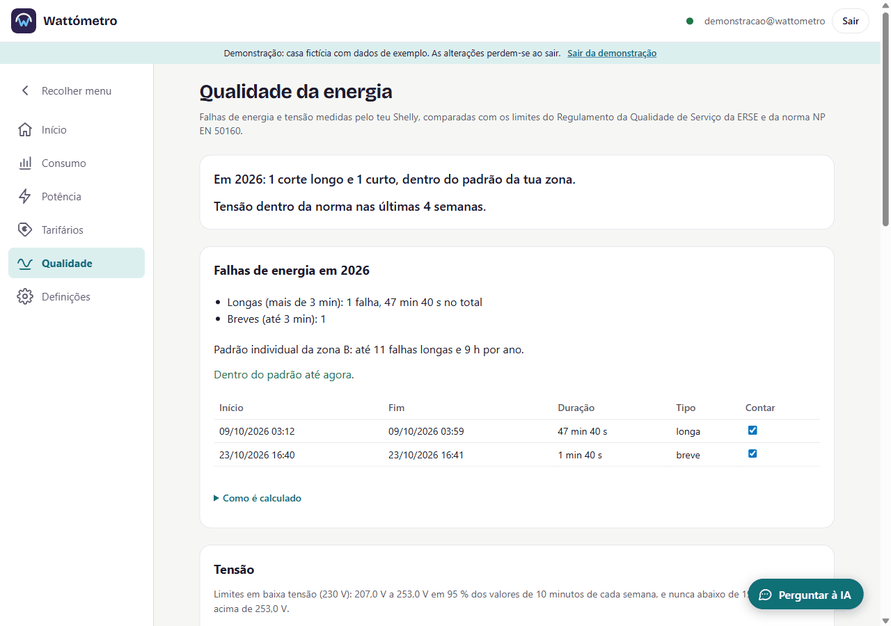

# Wattómetro

PWA gratuita para monitorizar e otimizar o consumo elétrico de uma casa portuguesa, a partir de um **Shelly EM Gen3** instalado no quadro elétrico e/ou do ficheiro de consumos a 15 minutos exportado do Balcão Digital da **E-Redes**.

Não é mais um gráfico: são **conclusões em euros e ações concretas** — potência contratada certa, tarifário mais barato para o teu perfil real, custo do consumo fantasma, fatura prevista do mês, quanto custa cada aparelho, aparelhos a degradar e registo de problemas de tensão para reclamar. IA opcional com a tua própria chave; a app funciona sem ela.

Estado: em desenvolvimento, em uso numa casa — ver [`planning/plan.md`](planning/plan.md).



## Como funciona


1. **No quadro elétrico**, uma pinça (transformador de corrente de 50 A, que abraça o cabo da fase sem o cortar) liga a um **Shelly EM Gen3**, um módulo DIN que também mede a tensão. A instalação deve ser feita por um eletricista: a app tem uma folha para lhe mostrar (Definições › Dispositivos › Instalar um Shelly).
2. O Shelly mede **a cada segundo** a potência, a tensão e o fator de potência. Um pequeno script do Wattómetro ([`shelly/`](shelly/)) envia, **uma vez por minuto**, pelo Wi-Fi de casa, o resumo do minuto e os 60 valores ao segundo. Não é preciso computador nem hub em casa. Se a Internet falhar, o Shelly guarda os minutos e envia-os depois.
3. Na **Cloudflare**, um Worker valida e grava as medições numa base D1 na UE; um Cron agrega-as a 15 minutos e ao dia.
4. A **app** (instalável no telemóvel ou no PC) pede esses dados e faz as contas no próprio aparelho: custos, tarifários, potência, aparelhos, tensão.
5. **Sem Shelly**, exportas do Balcão Digital da E-Redes o ficheiro com os consumos a 15 minutos; a app lê-o no browser e grava-o na mesma base. Os dois podem ser usados juntos: o histórico de um ano da E-Redes e, daí para a frente, o detalhe do Shelly.

## Shelly ou só a E-Redes?

A app funciona só com os dados da E-Redes, mas **sem o Shelly não há o detalhe, a granularidade nem boa parte das funcionalidades**. A E-Redes entrega um valor de energia por quarto de hora; o Shelly mede a cada segundo.

| | Só E-Redes (CSV) | Com Shelly |
|---|---|---|
| Detalhe | energia por quarto de hora | potência, tensão e fator de potência a cada segundo |
| Quando chegam os dados | pedes o ficheiro à mão no Balcão Digital; chega até 24 h depois e vai até ao dia anterior | a cada minuto, sozinho |
| Tarifário mais barato (ofertas da ERSE) | ✅ (precisa de um ano de dados) | ✅ |
| Consumo base, fatura prevista do mês | ✅, com os dias de atraso do ficheiro | ✅, até ao último minuto |
| Potência contratada | aproximada: a média de 15 min esconde os picos que fazem o contador cortar, e a app avisa disso | ✅ com o pico real de cada segundo, simulando o contador |
| Aparelhos: o que cada um gasta e custa | ❌ | ✅ reconhecidos pelos saltos de potência ao segundo |
| Tensão e falhas de energia (para reclamar à E-Redes) | ❌ | ✅ comparadas com o regulamento da ERSE e a norma NP EN 50160 |
| Avisos no telemóvel (pico de potência, dia fora do habitual) | ❌ | ✅ |
| Custo | nenhum | o Shelly e a instalação por um eletricista |

**Vantagens da E-Redes:** são os valores do contador oficial, os mesmos da fatura; não precisa de equipamento nem de obra; dá logo um ano de histórico, que é o que o simulador de tarifários precisa.

**Vantagens do Shelly:** tempo real (o último minuto), o segundo a segundo que permite ver os picos e reconhecer os aparelhos, a tensão e as falhas de energia, e avisos.

**Desvantagens do Shelly:** custa dinheiro e precisa de um eletricista; precisa de Wi-Fi no quadro; mede só o cabo onde está a pinça (deve ser a entrada geral, depois do disjuntor); não é o contador de faturação (pequenas diferenças face à E-Redes são normais); só tem dados a partir do dia em que é instalado.

**O melhor dos dois:** importar o último ano da E-Redes e instalar o Shelly. A app junta-os e diz de onde vem cada número.

## O que a app mostra

| | |
|---|---|
|  |  |
| **Potência:** o escalão mais baixo que não teria cortado a luz, simulando o contador segundo a segundo. | **Tarifários:** todas as ofertas da ERSE com o teu consumo real; carro elétrico, painéis solares e tarifa social. |
|  |  |
| **Aparelhos:** o que ligou e desligou, quanto gastou e custou; dás-lhes nome uma vez e a app reconhece-os. | **Qualidade:** falhas de energia e tensão fora dos limites, para reclamar com dados. |

As imagens são da **conta de demonstração** (uma casa fictícia), que qualquer pessoa pode abrir na página de entrada com "Ver demonstração", sem conta.

## Privacidade

- Os dados ficam numa conta Cloudflare do dono da instalação, numa base de dados na UE. Sem estatísticas nem registos remotos com dados de consumo.
- Os serviços externos (Open-Meteo para o clima, OMIE para os preços do mercado, PVGIS para a produção solar) nunca recebem consumos. Ver as regras em [`CLAUDE.md`](CLAUDE.md).
- A app funciona sem IA. Quando usada (com a tua chave da Anthropic), a IA só recebe resultados já calculados, nunca as séries de consumo em bruto.

## Usar o código na tua própria instalação

A app publicada em `app.wattometro.workers.dev` é a do autor, para uso familiar: **não tem registo público** (as contas são criadas pelo dono) e o plano gratuito da Cloudflare chega para poucas casas. Para a usares por tua conta, **crias a tua própria conta Cloudflare** (o plano gratuito chega para uma casa) e publicas lá o código. Os dados ficam na tua conta. Não é preciso mudar nada no código da app: só a configuração.

### O que precisas

- Node.js 24 e pnpm (`corepack enable pnpm`)
- Uma conta Cloudflare (o plano gratuito chega para uma casa)
- Opcional: um Shelly EM Gen3 no quadro

### Passos

```bash
git clone https://github.com/pmmrb1967/wattometro.git && cd wattometro
pnpm install
pnpm exec wrangler login                      # abre o browser para entrares na tua conta Cloudflare
pnpm exec wrangler whoami                     # mostra o account_id da tua conta
pnpm exec wrangler d1 create wattometro --jurisdiction eu   # base de dados na UE; mostra o database_id
```

Depois altera estes ficheiros (são os únicos com dados da instalação do autor):

| Ficheiro | O que mudar |
|---|---|
| `server/wrangler.toml` | `account_id` (o teu); `database_id` (o da base que criaste); `VAPID_SUBJECT` (um email teu) e `VAPID_PUBLIC_KEY` (a tua chave pública, ver abaixo) |
| `wrangler.app.toml` | `account_id` (o teu) |
| `.env` (copiar de `.env.example`; não vai para o Git) | `SHELLY_HOST`, `SHELLY_PASSWORD`, `SHELLY_INGEST_URL` (o teu endereço, ver abaixo) e `SHELLY_DEVICE_TOKEN`: só para instalar o script no Shelly a partir do teu computador |

Os segredos ficam só na Cloudflare (`pnpm exec wrangler secret put <NOME> -c server/wrangler.toml`):

| Segredo | Para quê |
|---|---|
| `SESSION_SECRET` | **obrigatório**: assina as sessões; pelo menos 32 caracteres aleatórios |
| `AI_KEY_SECRET` | opcional: cifra as chaves de IA que os utilizadores guardam |
| `VAPID_PRIVATE_KEY` | opcional: avisos no telemóvel; o comando para gerar o par de chaves está em [`docs/alerts.md`](docs/alerts.md). Sem ele, a app funciona sem avisos |
| `ADMIN_EMAILS` | opcional: quem vê o painel do servidor ([`docs/admin.md`](docs/admin.md)) |

Por fim, publica e cria a tua conta:

```bash
pnpm db:migrate:remote      # cria as tabelas
pnpm deploy:server          # Worker `api` (sem endereço público)
pnpm deploy:app             # Worker `app`: a app em https://app.<o-teu-subdomínio>.workers.dev
pnpm user:create --remote   # cria a tua conta (num terminal normal: pede o email, a password e o nome da casa)
```

O subdomínio `<o-teu-subdomínio>.workers.dev` é o da tua conta Cloudflare (aparece no painel, em Workers). Se já tiveres Workers chamados `app` ou `api`, muda o `name` nos dois `wrangler*.toml` e o `service` do `[[services]]` em `wrangler.app.toml`.

**Shelly:** na app, em Definições › Dispositivos, cria um dispositivo; a app mostra o endereço de envio (`https://app.<o-teu-subdomínio>.workers.dev/v1/ingest`) e o token. Põe-nos no `.env` e corre `pnpm shelly:install` com o computador na mesma rede do Shelly. Instruções completas em [`shelly/README.md`](shelly/README.md).

**Deploy automático (opcional):** num fork no GitHub, o CI (`.github/workflows/ci.yml`) verifica cada push e, se criares o segredo `CLOUDFLARE_API_TOKEN` no repositório, publica sozinho (migrações → `api` → `app`). Sem o token, só verifica.

### Limites do plano gratuito

Medido na casa do autor (com Shelly) nas 24 h até 29/10/2026: cerca de **3 milhões de linhas lidas** (limite gratuito de 5 milhões por dia) e **52 mil linhas escritas** (limite de 100 mil por dia) na base D1; a base tinha 10 MB, com um ano de E-Redes e 5 dias de Shelly (limite de 500 MB por base). Chega para uma casa; o plano Workers Paid (5 USD por mês) inclui o suficiente para cerca de 30 casas com Shelly, sem mudar o código. Casas só com a E-Redes gastam muito menos. Contas e opções em [`docs/hosting.md`](docs/hosting.md). Os limites estão em variáveis no `server/wrangler.toml` e a app avisa quando se aproxima deles.

## Desenvolvimento

```bash
pnpm dev                 # PWA em desenvolvimento (porta 5173); /v1 vai para pnpm dev:server
pnpm dev:server          # API local (wrangler dev, D1 local)
pnpm db:migrate:local    # migrações na base local
pnpm test                # testes (app e servidor, SQLite em memória)
pnpm typecheck && pnpm lint
```

As regras do projeto (unidades inteiras, dados de referência com fonte em [`docs/`](docs/), privacidade) estão em [`CLAUDE.md`](CLAUDE.md).

## Licença

[AGPL-3.0-or-later](LICENSE) © 2026 Paulo Barbosa. O nome "Wattómetro" não é coberto pela licença.
